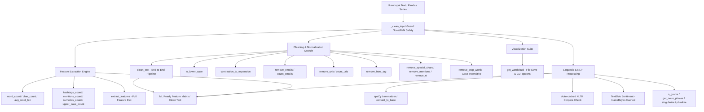

# NLP Text Preprocessing Utility Package

<p align="center">
  
</p>

<p align="center">
  <a href="https://pypi.org/project/nlp-text-preprocessing/">
    
  </a>
  <a href="https://pypi.org/project/nlp-text-preprocessing/">
    
  </a>
  <a href="https://pepy.tech/projects/nlp-text-preprocessing">
    
  </a>
  <a href="https://pepy.tech/projects/nlp-text-preprocessing">
    
  </a>
  <a href="https://github.com/udityamerit/Text-Processing-Package-For-Natural-Language-Processing/blob/main/LICENSE">
    
  </a>
</p>

---

## 📌 Overview

**`nlp_text_preprocessing`** is a production-grade, fast, and modular Python library designed to streamline text cleaning, feature extraction, linguistic analysis, and visualization for Natural Language Processing (NLP) pipelines and Machine Learning workflows.

Maintained by **[Uditya Narayan Tiwari](https://youtube.com/kgptalkie)**.

---

## 🏗 Architecture Diagram

The package is built with a decoupled, high-performance architecture integrating **spaCy**, **NLTK**, **TextBlob**, **BeautifulSoup4**, and **WordCloud** with safe null/NaN defensive wrappers for seamless Pandas DataFrame processing.

<p align="center">
  
</p>

### Pipeline Architecture Workflow



---

## 🚀 Quick Installation

### From PyPI
```bash
pip install nlp_text_preprocessing
```

### From GitHub (Latest Development Version)
```bash
pip install git+https://github.com/udityamerit/Text-Processing-Package-For-Natural-Language-Processing.git --upgrade --force-reinstall
```

### Automatic Resource Setup
Download required NLTK corpora (`stopwords`, `movie_reviews`, `brown`, etc.) and spaCy language models (`en_core_web_sm`):
```python
import nlp_text_preprocessing as tp

# Downloads all required NLTK corpora automatically
tp.download_nltk_packages()
```

---

## 📚 Complete API Reference & Function List

Below is the complete list of all **34 functions** available in the `nlp_text_preprocessing` package:

### 1. General Feature Extraction Functions

| Function Name | Parameters | Return Type | Description |
| :--- | :--- | :--- | :--- |
| `word_count(x)` | `x: str` | `int` | Returns total number of whitespace-separated words. |
| `char_count(x)` | `x: str` | `int` | Returns total characters excluding whitespace. |
| `avg_word_len(x)` | `x: str` | `float` | Returns average word length (safely returns `0.0` on empty input). |
| `stop_words_count(x)` | `x: str` | `int` | Returns count of stop words (case-insensitive check). |
| `hashtags_count(x)` | `x: str` | `int` | Returns count of hashtags (`#tag`). |
| `mentions_count(x)` | `x: str` | `int` | Returns count of user mentions (`@user`). |
| `numerics_count(x)` | `x: str` | `int` | Returns count of standalone numeric tokens. |
| `upper_case_count(x)` | `x: str` | `int` | Returns count of uppercase words. |
| `extract_features(x)` | `x: str` | `dict` | Returns a dictionary containing all extracted text features at once. |

---

### 2. Text Cleaning & Normalization Functions

| Function Name | Parameters | Return Type | Description |
| :--- | :--- | :--- | :--- |
| `to_lower_case(x)` | `x: str` | `str` | Converts input text to lowercase. |
| `contraction_to_expansion(x)` | `x: str` | `str` | Expands abbreviations and contractions using contractions lookup table. |
| `remove_emails(x)` | `x: str` | `str` | Strips email addresses from text. |
| `count_emails(x)` | `x: str` | `int` | Returns count of email addresses found in text. |
| `remove_urls(x)` | `x: str` | `str` | Strips HTTP/HTTPS URLs and `www` links from text. |
| `count_urls(x)` | `x: str` | `int` | Returns count of URLs found in text. |
| `remove_rt(x)` | `x: str` | `str` | Removes retweet tags (`RT @user`). |
| `count_rt(x)` | `x: str` | `int` | Returns count of retweet markers in text. |
| `remove_html_tag(x)` | `x: str` | `str` | Strips HTML/XML tags using BeautifulSoup parser. |
| `remove_accented_chars(x)` | `x: str` | `str` | Normalizes and converts accented characters (NFKD -> ASCII). |
| `remove_mentions(x)` | `x: str` | `str` | Strips user handles (`@username`). |
| `remove_special_chars(x)` | `x: str` | `str` | Removes punctuation and non-alphanumeric special symbols. |
| `remove_repeated_chars(x)` | `x: str` | `str` | Truncates character repetitions beyond 2 consecutive occurrences. |
| `remove_stop_words(x)` | `x: str` | `str` | Removes stop words (case-insensitive, preserving capitalized text structure). |
| `clean_text(text)` | `text: str` | `str` | Executes full end-to-end cleaning pipeline (lowercasing, contractions, emails, URLs, HTML, special chars, lemmatization). |

---

### 3. Linguistic & Morphological Processing Functions

| Function Name | Parameters | Return Type | Description |
| :--- | :--- | :--- | :--- |
| `convert_to_base(x)` | `x: str` | `str` | Lemmatizes nouns and verbs via spaCy while keeping other POS tags intact. |
| `lemmatize(x)` | `x: str` | `str` | Performs full lemmatization across all tokens via spaCy (`en_core_web_sm`). |
| `correct_spelling(x)` | `x: str` | `str` | Corrects word spelling using TextBlob dictionary model. |
| `get_noun_phrase(x)` | `x: str` | `list[str]` | Extracts noun phrases from text. |
| `n_grams(x, n=2)` | `x: str, n: int` | `list` | Generates word-level n-grams. |
| `singularize_words(x)` | `x: str` | `str` | Converts plural nouns (`NNS`) into singular forms. |
| `pluralize_words(x)` | `x: str` | `str` | Converts singular nouns (`NN`) into plural forms. |
| `sentiment_analysis(x)` | `x: str` | `str` | Returns sentiment classification (`'pos'` / `'neg'`) using module-cached NaiveBayesAnalyzer. |

---

### 4. Visualization Functions

| Function Name | Parameters | Return Type | Description |
| :--- | :--- | :--- | :--- |
| `get_wordcloud(x, save_path=None, show=True)` | `x: str, save_path: str, show: bool` | `WordCloud` | Generates a WordCloud image object, with optional file saving and GUI display options. |

---

## 💻 Usage Code Examples

### 1. Cleaning Raw Text
```python
import nlp_text_preprocessing as tp

raw_text = "Check out https://example.com! Contact support@company.org or RT @user 'I'm loving #NLP'."
cleaned = tp.clean_text(raw_text)

print(cleaned)
# Output: check out contact support company org or i am love nlp
```

### 2. Processing Pandas DataFrames
All functions safely handle `None`, `NaN`, and missing values:
```python
import pandas as pd
import nlp_text_preprocessing as tp

df = pd.DataFrame({
    'text': [
        "I'm loving this NLP package! #awesome",
        "Contact me at info@test.com or visit https://test.com",
        None
    ]
})

# Apply full cleaning pipeline
df['clean_text'] = df['text'].apply(tp.clean_text)

# Extract word counts
df['word_count'] = df['text'].apply(tp.word_count)

# Extract full feature dictionary as DataFrame columns
features_df = df['text'].apply(tp.extract_features).apply(pd.Series)
print(features_df)
```

### 3. WordCloud Generation & Saving
```python
import nlp_text_preprocessing as tp

text = "python natural language processing machine learning text mining data science spaCy nltk textblob"

# Save directly to file without requiring GUI display window
tp.get_wordcloud(text, save_path="wordcloud.png", show=False)
```

---

## 🛠 Setup & Requirements

- `spacy >= 3.0`
- `textblob`
- `beautifulsoup4`
- `nltk`
- `wordcloud`
- `pandas`
- `numpy`
- `matplotlib`

---

## 📄 License

Distributed under the MIT License. See [`LICENSE`](LICENSE) for more information.
