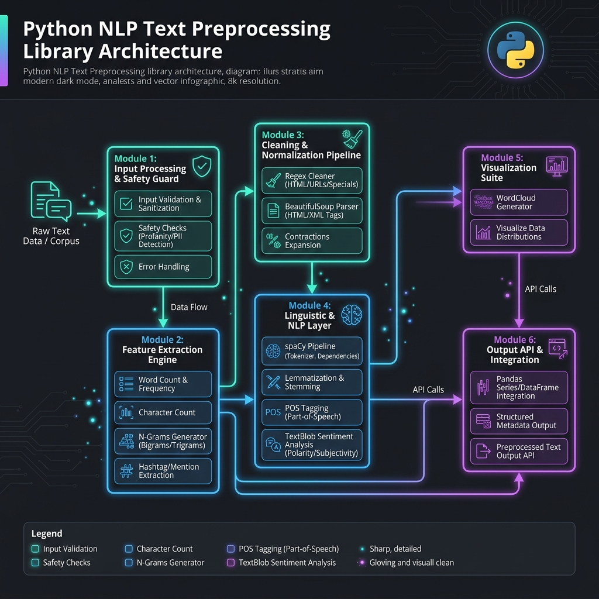

# NLP Text Preprocessing Utility Package

<p align="center">
  
</p>

<p align="center">
  <a href="https://pypi.org/project/nlp-text-preprocessing/">
    
  </a>
  <a href="https://pypi.org/project/nlp-text-preprocessing/">
    
  </a>
  <a href="https://pepy.tech/projects/nlp-text-preprocessing">
    
  </a>
  <a href="https://pepy.tech/projects/nlp-text-preprocessing">
    
  </a>
  <a href="https://github.com/udityamerit/Text-Processing-Package-For-Natural-Language-Processing/blob/main/LICENSE">
    
  </a>
</p>

---

## Table of Contents

- [Package Overview](#package-overview)
- [Hands-On Notebook Guide](#hands-on-notebook-guide)
- [What's New in 0.5.0](#whats-new-in-050)
- [Key Features](#key-features)
- [Architecture Diagram](#architecture-diagram)
- [Quickstart and Setup](#quickstart-and-setup)
- [Pipeline Automation Engine](#pipeline-automation-engine)
- [Preparing Text for Transformers](#preparing-text-for-transformers-bert-gpt-)
- [Command Line (`nlp-prep`)](#command-line-nlp-prep)
- [Complete API Reference](#complete-api-reference)
  - [1. General Feature Extraction](#1-general-feature-extraction)
  - [2. Text Cleaning and Normalization](#2-text-cleaning-and-normalization)
  - [3. Linguistic and Morphological Processing](#3-linguistic-and-morphological-processing)
  - [4. Safety, Moderation and Sentiment](#4-safety-moderation-and-sentiment)
  - [5. Visualization Suite](#5-visualization-suite)
- [Code Examples](#code-examples)
  - [Basic Text Cleaning](#1-basic-text-cleaning)
  - [Pipeline Engine Usage](#2-pipeline-engine-usage)
  - [Pandas DataFrame Integration](#3-pandas-dataframe-integration)
  - [Batch Feature Extraction](#4-batch-feature-extraction)
  - [WordCloud Generation](#5-wordcloud-generation)
  - [Readability Scores](#6-readability-scores)
  - [Masking Personal Data, Including Names](#7-masking-personal-data-including-names)
  - [Fast Batch Processing](#8-fast-batch-processing)
- [Type Hints](#type-hints)
- [Development](#development)
- [Troubleshooting and Resource Setup](#troubleshooting-and-resource-setup)
- [License and Author](#license-and-author)

---

## Package Overview

**`nlp_text_preprocessing`** is a modular Python library designed to streamline text cleaning, feature extraction, linguistic analysis, content moderation, and visualization for Natural Language Processing (NLP) pipelines and Machine Learning workflows.

Maintained by **[Uditya Narayan Tiwari](https://udityanarayantiwari.netlify.app/)**.

It provides over **60 single-purpose functions** and an extensible **Pipeline Engine** with defensive guards so `None`, `NaN` and missing values are treated as empty text, which makes it convenient to run over Pandas DataFrame columns and raw text datasets.

---

## Hands-On Notebook Guide

A complete, cell-by-cell walkthrough with every output saved, so you can see what each function does before you install anything:

**[NLP_Text_Preprocessing_Complete_Guide.ipynb](examples/NLP_Text_Preprocessing_Complete_Guide.ipynb)** &nbsp; [](https://colab.research.google.com/github/udityamerit/Text-Processing-Package-For-Natural-Language-Processing/blob/main/examples/NLP_Text_Preprocessing_Complete_Guide.ipynb)

It has 13 parts: install and setup, safe inputs, features and readability, cleaning, emojis and PII masking, linguistic functions, moderation and sentiment, the `Pipeline` (arguments, save/load, batching), pandas and scikit-learn, transformers helpers, the `nlp-prep` command line, word clouds, and a cheat sheet.

---

## What's New in 0.5.0

- **`readability_scores(x)`**: five readability measures in one dictionary (Flesch Reading Ease, Flesch-Kincaid grade, Gunning Fog, ARI, Coleman-Liau). See [Readability Scores](#6-readability-scores).
- **`mask_pii(x, names=True)`**: also redacts people's names with spaCy's entity recogniser. Off by default. See [Masking Personal Data](#7-masking-personal-data-including-names).
- **Faster batches**: `Pipeline.run_batch`, `transform` and `run_series` process the spaCy steps with `nlp.pipe` (about 2x faster, identical output).
- **Type hints** on the public API and a `py.typed` marker, so mypy, Pyright and IDEs use them. See [Type Hints](#type-hints).
- **Developer tooling**: ruff, mypy, coverage, Python 3.13 in CI and Dependabot. See [Development](#development).

Everything from earlier versions still works the same way. The full history is in [CHANGELOG.md](CHANGELOG.md).

---

## Key Features

- **Safe Inputs**: `None`, `NaN`, `pd.NA` and bytes are handled by every function (treated as empty text).
- **Pipeline Automation Engine**: Chain cleaning steps by name or custom functions via `Pipeline(['to_lower_case', 'remove_urls', 'lemmatize'])`.
- **Light Import, Lazy Models**: `import nlp_text_preprocessing` loads no heavy library and downloads nothing. spaCy, TextBlob and NLTK data are loaded on first use and cached.
- **Advanced Cleaning**: Remove emojis, phone numbers, PII mask, URLs, emails, HTML, retweets, special symbols, and expand contractions/hashtags.
- **Feature & Readability Extraction**: Extract word counts, sentence counts, readability scores (Flesch Ease, plus Flesch-Kincaid, Gunning Fog, ARI and Coleman-Liau via `readability_scores`), punctuation density, capital ratios, and full batch statistics.
- **Linguistic Utilities**: Named Entity Recognition (NER), POS tagging, dependency parsing, language detection, keyword extraction, synonyms, antonyms, and n-grams.
- **Safety & Moderation (baseline)**: Lexicon-based profanity, toxicity, spam and emotion helpers. They are transparent keyword baselines, not a moderation system: use a trained model for anything high-stakes.
- **Visualization**: Generate and save custom WordClouds to disk or display interactively.
- **Fast Batches**: `Pipeline.run_batch` / `run_series` use spaCy's `nlp.pipe` for the spaCy steps.
- **Typed**: annotated public API with a `py.typed` marker.

---

## Architecture Diagram

The package integrates **spaCy**, **NLTK**, **TextBlob**, **BeautifulSoup4**, and **WordCloud** through a unified API surface:

<p align="center">
  
</p>

---

## Quickstart and Setup

### 1. Installation

```bash
pip install nlp-text-preprocessing            # core
pip install "nlp-text-preprocessing[viz]"     # + wordcloud, matplotlib (get_wordcloud)
pip install "nlp-text-preprocessing[pandas]"  # + pandas (text_stats_batch, Pipeline.run_series)
pip install "nlp-text-preprocessing[sklearn]" # + scikit-learn (TextPreprocessor)
pip install "nlp-text-preprocessing[transformers]" # + transformers (tokenizers for truncate_text / chunk_text)
pip install "nlp-text-preprocessing[all]"     # everything optional
pip install "nlp-text-preprocessing[dev]"     # tests, ruff, mypy (for contributors)
```

### 2. Downloading Required Corpora and Models

Nothing is downloaded behind your back. Run the one-time setup, which fetches the NLTK data (`punkt_tab`, `wordnet`, `omw-1.4`) and the spaCy model `en_core_web_sm`:

```python
import nlp_text_preprocessing as tp

tp.download_nltk_packages()                 # one-time setup
tp.check_resources(verbose=True)            # see what is installed / missing
```

`sentiment_analysis(x, method="naive_bayes")` additionally needs the `movie_reviews` corpus:
`tp.download_nltk_packages(include_sentiment_corpus=True)`.
Set the environment variable `NLP_TEXT_PREPROCESSING_AUTO_DOWNLOAD=1` if you want the spaCy model to be downloaded automatically on first use.

---

## Pipeline Automation Engine

The `Pipeline` class allows chaining cleaning and transformation steps cleanly:

```python
import nlp_text_preprocessing as tp

# 1. Create default zero-config pipeline
pipe = tp.Pipeline.default()

# 2. Or build a custom step pipeline
pipe = tp.Pipeline([
    'to_lower_case',
    'expand_hashtags',
    'remove_urls',
    'remove_emails',
    'remove_extra_whitespace',
    'lemmatize'
])

# Process single text
clean_result = pipe.run("Check out #MachineLearning at https://example.com!")

# Process batch list or Pandas Series
clean_batch = pipe.run_batch(["Text 1", "Text 2"])
clean_series = pipe.run_series(df['text_column'])

# Generate diff report of changes
report = tp.diff_report(raw_texts, clean_batch)
```

`run_batch` and `run_series` are faster than looping over `run`: the spaCy steps (`lemmatize`, `convert_to_base`, `singularize_words`, `pluralize_words`) process the whole list with spaCy's `nlp.pipe` (about 2x faster in our test; the result is identical). `run_series` keeps the Series index and name.

### Steps with arguments, saving and scikit-learn

```python
# Pass arguments as (name, {argument: value})
pipe = tp.Pipeline([
    'to_lower_case',
    ('remove_stop_words', {'keep_negations': False}),
])
print(pipe)   # Pipeline(['to_lower_case', "remove_stop_words{'keep_negations': False}"])

# Save and reload (custom functions must be registered with @tp.register_step('name'))
pipe.save('my_pipeline.json')
pipe = tp.Pipeline.load('my_pipeline.json')

# Use it inside scikit-learn:  pip install "nlp-text-preprocessing[sklearn]"
from sklearn.pipeline import make_pipeline
from sklearn.feature_extraction.text import TfidfVectorizer

model = make_pipeline(tp.TextPreprocessor(['to_lower_case', 'remove_special_chars']),
                      TfidfVectorizer())
X = model.fit_transform(["Hello, World!", "HELLO there"])
```

Every step except the last must return a string. The last step may return anything,
for example `Pipeline(['to_lower_case', 'text_stats'])`.

---

## Preparing Text for Transformers (BERT, GPT, ...)

Modern models work best with *lightly* cleaned text: keep the case, punctuation and
word forms, and only remove noise. `light_clean` does exactly that, and `truncate_text`
/ `chunk_text` help you stay inside a model's token limit.

```python
import nlp_text_preprocessing as tp

tp.light_clean("<p>Great &amp; fast!​ Visit https://x.com or mail me@x.com</p>",
               urls='[URL]', emails='[EMAIL]')
# 'Great & fast! Visit [URL] or mail [EMAIL]'

# Use the real tokenizer so the limits are counted in model tokens
# (pip install "nlp-text-preprocessing[transformers]")
from transformers import AutoTokenizer
tok = AutoTokenizer.from_pretrained('bert-base-uncased')

tp.truncate_text(long_text, 256, tokenizer=tok)
chunks = tp.chunk_text(long_text, 256, overlap=32, tokenizer=tok)
```

Without a `tokenizer`, the limits are counted in whitespace-separated words.
`tokenizer` may be a HuggingFace tokenizer (anything with `.tokenize()` and
`.convert_tokens_to_string()`) or a plain function that returns a list of tokens.

---

## Command Line (`nlp-prep`)

Installing the package also installs the `nlp-prep` command (`python -m nlp_text_preprocessing` works too).

```bash
# one document per line, written to a new file
nlp-prep clean reviews.txt -o reviews_clean.txt

# a CSV column (adds a 'text_clean' column; use --output-column text to overwrite)
nlp-prep clean data.csv --column text -o data_clean.csv

# standard input / output
cat notes.txt | nlp-prep clean - --lowercase --url-token "[URL]"

# classic cleaning, or your own steps / a saved Pipeline
nlp-prep clean reviews.txt --mode standard --stopwords
nlp-prep clean reviews.txt --steps to_lower_case,remove_urls
nlp-prep clean reviews.txt --pipeline my_pipeline.json

# check or install the NLTK data and spaCy model
nlp-prep resources --download
```

---

## Complete API Reference

Below is the complete reference guide for all functions available in the library:

### 1. General Feature Extraction

| Function | Parameters | Return Type | Description |
| :--- | :--- | :--- | :--- |
| `word_count(x)` | `x: str` | `int` | Returns total whitespace-separated word count. |
| `char_count(x)` | `x: str` | `int` | Returns total characters excluding spaces. |
| `avg_word_len(x)` | `x: str` | `float` | Returns average word length (`0.0` for empty inputs). |
| `stop_words_count(x)` | `x: str` | `int` | Returns count of stop words (case-insensitive). |
| `sentence_count(x)` | `x: str` | `int` | Returns total number of sentences. |
| `avg_sentence_len(x)` | `x: str` | `float` | Returns average sentence length in words. |
| `punctuation_density(x)`| `x: str` | `float` | Returns proportion of punctuation characters in text. |
| `capital_ratio(x)` | `x: str` | `float` | Returns proportion of uppercase words relative to total words. |
| `unique_word_ratio(x)` | `x: str` | `float` | Returns lexical diversity ratio (unique words / total words). |
| `readability_score(x)` | `x: str` | `float` | Calculates Flesch Reading Ease score. |
| `readability_scores(x)` | `x: str` | `dict` | Flesch Reading Ease, Flesch-Kincaid grade, Gunning Fog, Automated Readability Index and Coleman-Liau (English, approximate). |
| `hashtags_count(x)` | `x: str` | `int` | Returns count of hashtag tokens (`#tag`). |
| `mentions_count(x)` | `x: str` | `int` | Returns count of user handle mentions (`@user`). |
| `numerics_count(x)` | `x: str` | `int` | Returns count of numeric tokens. |
| `upper_case_count(x)` | `x: str` | `int` | Returns count of uppercase words. |
| `text_stats(x)` | `x: str` | `dict` | Returns a dictionary containing all extracted feature statistics at once. |
| `text_stats_batch(df, col)`| `df, col` | `DataFrame` | Returns a DataFrame of stats for a pandas DataFrame column. |

---

### 2. Text Cleaning and Normalization

| Function | Parameters | Return Type | Description |
| :--- | :--- | :--- | :--- |
| `to_lower_case(x)` | `x: str` | `str` | Converts input text to lowercase. |
| `contraction_to_expansion(x)`| `x: str` | `str` | Expands contractions using contractions dictionary. |
| `remove_emails(x)` | `x: str` | `str` | Removes email addresses from text. |
| `count_emails(x)` | `x: str` | `int` | Counts email addresses present in text. |
| `remove_urls(x)` | `x: str` | `str` | Removes `http(s)://`, `ftp://` and `www.` URLs (trailing punctuation is kept). |
| `count_urls(x)` | `x: str` | `int` | Counts URLs present in text. |
| `remove_rt(x)` | `x: str` | `str` | Removes retweet headers (`RT @user:`). |
| `count_rt(x)` | `x: str` | `int` | Counts retweet occurrences in text. |
| `remove_html_tag(x)` | `x: str` | `str` | Strips HTML/XML tags using BeautifulSoup. |
| `remove_accented_chars(x)` | `x: str` | `str` | Strips accents (`café` -> `cafe`); non-Latin scripts are kept. |
| `remove_mentions(x)` | `x: str` | `str` | Removes user handle mentions (`@username`). |
| `remove_special_chars(x)` | `x: str` | `str` | Strips punctuation and symbols (`well-known` -> `well known`). |
| `remove_repeated_chars(x)` | `x: str` | `str` | Shortens elongated words (`soooo` -> `soo`); digits and punctuation are untouched. |
| `remove_stop_words(x, keep_negations=True)` | `x: str` | `str` | Removes stop words (case-insensitive); negations like `not` are kept by default. |
| `remove_emojis(x)` | `x: str` | `str` | Strips emoji (flags, skin tones and ZWJ sequences included). |
| `extract_emojis(x)` | `x: str` | `list[str]` | Returns list of emojis found in text. |
| `emoji_to_text(x)` | `x: str` | `str` | Converts emojis to descriptive text (e.g. 😂 -> `face_with_tears_of_joy`). |
| `remove_phone_numbers(x)` | `x: str` | `str` | Strips phone numbers (international formats; dates and decimals are ignored). |
| `count_phone_numbers(x)` | `x: str` | `int` | Counts phone numbers present in text. |
| `mask_pii(x, token='[REDACTED]', names=False)` | `x: str` | `str` | Redacts emails, card numbers, US SSNs and phone numbers. `names=True` also redacts people's names with spaCy's entity recogniser (statistical, so review the result). |
| `remove_extra_whitespace(x)`| `x: str` | `str` | Collapses consecutive spaces, tabs, and newlines to a single space. |
| `expand_hashtags(x)` | `x: str` | `str` | Splits hashtags (`#MachineLearning2024` -> `Machine Learning 2024`). |
| `normalize_unicode_punctuation(x)`| `x: str` | `str` | Replaces smart quotes, em-dashes, and ellipsis with ASCII equivalents. |
| `remove_numbers(x)` | `x: str` | `str` | Removes standalone numbers; digits inside words (`3rd`, `H2O`) stay. |
| `remove_currency_symbols(x)`| `x: str` | `str` | Strips every Unicode currency symbol. |
| `normalize_whitespace_and_casing(x)`| `x: str` | `str` | Canonical combination of lowercasing and whitespace collapse. |
| `clean_text(text, remove_stopwords=False)` | `text: str` | `str` | End-to-end cleaning (HTML, URLs, emails, lower-case, contractions, punctuation, lemmatization). |
| `light_clean(x, html=True, urls='', emails='', mentions=None, emojis=None, normalize='NFKC', keep_newlines=False, lowercase=False)` | `x: str` | `str` | Minimal cleaning for transformer models: Unicode normalisation, zero-width/control characters, HTML and entities, URLs/emails/mentions (remove, replace or keep), optional emoji handling. Case and punctuation are kept. |
| `truncate_text(x, max_tokens, tokenizer=None)` | `x: str` | `str` | Keeps the first `max_tokens` tokens (words, or tokens of a HuggingFace-style tokenizer). |
| `chunk_text(x, max_tokens, overlap=0, tokenizer=None)` | `x: str` | `list[str]` | Splits long text into pieces of at most `max_tokens`, with optional overlap. |

---

### 3. Linguistic and Morphological Processing

| Function | Parameters | Return Type | Description |
| :--- | :--- | :--- | :--- |
| `convert_to_base(x)` | `x: str` | `str` | Lemmatizes nouns and verbs via spaCy while keeping other POS tags. |
| `lemmatize(x)` | `x: str` | `str` | Performs full lemmatization across all tokens via spaCy. |
| `extract_entities(x)` | `x: str` | `list[tuple]` | Extracts named entities `(text, label)` using spaCy. |
| `extract_pos_tags(x)` | `x: str` | `list[tuple]` | Extracts full POS tag breakdown `(token, pos, tag)` using spaCy. |
| `get_dependency_tree(x)`| `x: str` | `list[tuple]` | Extracts dependency parse tree `(token, dep, head)` using spaCy. |
| `detect_language(x)` | `x: str` | `str` | Language code (`'en'`, `'fr'`, `'hi'`, ...) via `langdetect`; `'unknown'` if undetectable. |
| `keyword_extraction(x, top_n)`| `x: str, top_n: int`| `list[str]`| Extracts top N keywords by term frequency. |
| `text_similarity(x1, x2)` | `x1, x2` | `float` | Calculates token Jaccard similarity between two texts (0.0 to 1.0). |
| `get_synonyms(word)` | `word: str` | `list[str]` | Sorted WordNet synonyms. |
| `get_antonyms(word)` | `word: str` | `list[str]` | Sorted WordNet antonyms. |
| `chunk_noun_phrases(x)` | `x: str` | `list[dict]` | spaCy noun chunks with exact character `start`/`end` offsets. |
| `correct_spelling(x)` | `x: str` | `str` | Corrects misspelled words (TextBlob); punctuation, case, URLs and acronyms are preserved. |
| `get_noun_phrase(x)` | `x: str` | `list[str]` | Extracts noun phrases from text. |
| `n_grams(x, n=2)` | `x: str, n: int` | `list[tuple]` | Word-level n-grams as tuples. |
| `singularize_words(x)` | `x: str` | `str` | Converts plural nouns (`NNS`) into singular forms. |
| `pluralize_words(x)` | `x: str` | `str` | Converts singular nouns (`NN`) into plural forms. |

---

### 4. Safety, Moderation and Sentiment

| Function | Parameters | Return Type | Description |
| :--- | :--- | :--- | :--- |
| `detect_profanity(x, include_mild=True, extra_words=(), allow_words=())` | `x: str` | `bool` | True if the text has profanity. Matches endings (`shitty`) and leetspeak (`sh1t`); ignores `Hell's Kitchen`; `include_mild=False` skips words like `damn`. Masked words such as `f***` are not detected. |
| `censor_profanity(x, include_mild=True, extra_words=(), allow_words=(), mask_char='*')` | `x: str` | `str` | Masks each profane word, keeping its length and the text layout. |
| `detect_toxicity(x)` | `x: str` | `float` | Score from 0.0 to 1.0. Counts insults and threats aimed at people; `kill the process` and `I do not hate you` score 0. |
| `toxicity_report(x)` | `x: str` | `dict` | Explains the score: `score`, `matches` (word, weight, targeted) and `ignored` (negated) words. |
| `detect_spam_signals(x)` | `x: str` | `dict` | Flags shouting, punctuation runs, links and spam phrases (`spam_phrases`); `is_spam_candidate` needs at least two signals. Short texts like `OK` are not flagged. |
| `sentiment_analysis(x, method='pattern')` | `x: str` | `str` | `'pos'` / `'neg'` / `'neu'`. Default is instant; `method='naive_bayes'` is the legacy opt-in model. |
| `polarity_subjectivity(x)`| `x: str` | `dict` | Returns fast pattern-based sentiment polarity (-1.0 to 1.0) and subjectivity. |
| `emotion_detection(x)` | `x: str` | `dict` | Emotion counts (joy, anger, sadness, fear). Handles endings (`loved`, `happier`) and ignores negated words (`not happy`). |

---

### 5. Visualization Suite

| Function | Parameters | Return Type | Description |
| :--- | :--- | :--- | :--- |
| `get_wordcloud(x, save_path=None, show=True)` | `x: str, save_path: str, show: bool` | `WordCloud` | Generates a WordCloud object, with optional file saving and GUI toggle options. |

---

## Code Examples

### 1. Basic Text Cleaning

```python
import nlp_text_preprocessing as tp

raw_text = "Check out https://example.com! Contact support@company.org or RT @user 'I'm loving #NLP'."
cleaned = tp.clean_text(raw_text)

print(cleaned)
# Output: check out contact support company org or i am love nlp
```

### 2. Pipeline Engine Usage

```python
import nlp_text_preprocessing as tp

# Build custom pipeline
pipe = tp.Pipeline(['to_lower_case', 'expand_hashtags', 'remove_urls', 'remove_extra_whitespace'])

text = "Check out #MachineLearning at https://example.com!"
print(pipe.run(text))
# Output: check out machine learning at!
```

### 3. Pandas DataFrame Integration

All functions seamlessly support Pandas `.apply()` and handle missing values (`NaN`/`None`):

```python
import pandas as pd
import nlp_text_preprocessing as tp

df = pd.DataFrame({
    'text': [
        "I'm loving this NLP package! #awesome",
        "Contact me at info@test.com or visit https://test.com",
        None
    ]
})

# Apply end-to-end text cleaning
df['clean_text'] = df['text'].apply(tp.clean_text)

# Extract word counts safely
df['word_count'] = df['text'].apply(tp.word_count)
```

### 4. Batch Feature Extraction

Extract full feature matrices directly into Pandas columns:

```python
import pandas as pd
import nlp_text_preprocessing as tp

df = pd.DataFrame({'text': ["Hello #world! Visit https://example.com", "Contact user@test.com"]})

# Extract all summary stats into a new DataFrame
stats_df = tp.text_stats_batch(df, 'text')
print(stats_df)
```

### 5. WordCloud Generation

```python
import nlp_text_preprocessing as tp

text = "python natural language processing machine learning text mining data science spaCy nltk textblob"

# Save directly to disk without opening interactive GUI window
tp.get_wordcloud(text, save_path="wordcloud.png", show=False)
```

### 6. Readability Scores

```python
import nlp_text_preprocessing as tp

scores = tp.readability_scores("The cat sat on the mat. It was a sunny day.")
print(scores)
# {'flesch_reading_ease': ..., 'flesch_kincaid_grade': ..., 'gunning_fog': ...,
#  'automated_readability_index': ..., 'coleman_liau': ...}

# Higher Flesch = easier. The other four are US school grade levels (higher = harder).
# Empty or None text returns 0.0 for every key.
```

`tp.readability_score(x)` still returns only the Flesch Reading Ease number. The scores are approximate and meant for English.

### 7. Masking Personal Data, Including Names

```python
import nlp_text_preprocessing as tp

text = "Barack Obama emailed me at obama@example.com or 555-123-4567."

tp.mask_pii(text)
# 'Barack Obama emailed me at [REDACTED] or [REDACTED].'   (names are left alone by default)

tp.mask_pii(text, names=True)
# '[REDACTED] emailed me at [REDACTED] or [REDACTED].'   (needs the spaCy model; run tp.download_nltk_packages() once)

tp.mask_pii(text, token='<PII>', names=True)   # custom replacement token
```

Names are found by spaCy's statistical entity recogniser, so it can miss or over-match some names. Review the output when privacy matters.

### 8. Fast Batch Processing

```python
import nlp_text_preprocessing as tp

pipe = tp.Pipeline(['to_lower_case', 'remove_urls', 'lemmatize'])

texts = ["Dogs are barking at https://example.com", "Cats were running"] * 500
clean = pipe.run_batch(texts)             # list in, list out
clean_series = pipe.run_series(df['text'])  # keeps the Series index and name
```

---

## Type Hints

The package ships a `py.typed` marker and annotated function signatures, so type checkers and IDEs show parameter and return types:

```python
import nlp_text_preprocessing as tp

n: int = tp.word_count("hello world")
scores: dict = tp.readability_scores("Hello there.")
```

---

## Development

```bash
git clone https://github.com/udityamerit/Text-Processing-Package-For-Natural-Language-Processing.git
cd Text-Processing-Package-For-Natural-Language-Processing
pip install -e ".[dev,all]"
python -m spacy download en_core_web_sm

pytest -q --cov          # tests with coverage
ruff check .             # lint
mypy                     # type check
```

CI runs the same checks on Python 3.10 to 3.13. Release steps, and how to set up PyPI Trusted Publishing, are in [RELEASING.md](RELEASING.md).

---

## Troubleshooting and Resource Setup

If a function reports a missing NLTK corpus or spaCy model, check what is missing and install it:

```python
import nlp_text_preprocessing as tp
tp.check_resources(verbose=True)
tp.download_nltk_packages()
```

Or manually download spaCy model via terminal:
```bash
python -m spacy download en_core_web_sm
```

---

## License and Author

- **Author**: [Uditya Narayan Tiwari](https://udityanarayantiwari.netlify.app/)
- **License**: MIT License ([LICENSE](LICENSE))
